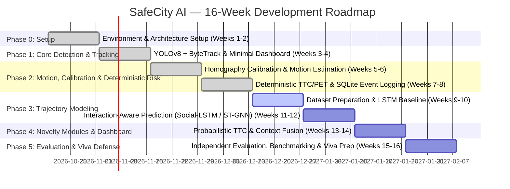

# SafeCity AI: Project Status & 16-Week Research Roadmap

## 1. Honest Component Status Table

Status definitions:
* **Not started**: No implementation, model, or configuration exists yet.
* **Implemented**: Code written and integrated in repository.
* **Tested**: Verified via automated unit/integration tests or validation script.
* **Trained**: Model weights trained or fine-tuned on benchmark/custom data.
* **Evaluated**: Quantitative performance metrics computed and documented.
* **Blocked**: Awaiting user data, hardware, or external access approval.

| Pipeline Component | Module Category | PPT Proposal Baseline / Novelty | Current Status | Notes & Blockers |
| :--- | :--- | :--- | :--- | :--- |
| **Repository & Environment Setup** | Infrastructure | Foundation | **Implemented** | Python 3.11 `.venv`, folder tree, configs, data validator |
| **Data Acquisition & Verification** | Data Pipeline | Foundation | **Implemented & Tested** | Sample traffic video downloaded & verified |
| **Video Decoding & Preprocessing** | Core Pipeline | Baseline | **Implemented & Tested** | OpenCV frame reader with FPS / resolution extraction |
| **Object Detection (COCO Baseline)** | Core Pipeline | Baseline | **Implemented & Tested** | YOLOv8n inference (72.1 FPS on Apple Silicon M5) |
| **Multi-Object Tracking (ByteTrack)**| Core Pipeline | Baseline | **Implemented & Tested** | ByteTrack with persistent IDs & trajectory trails |
| **Camera Calibration (Homography)** | Motion Estimation | Baseline | **Implemented & Tested** | Planar H matrix with reprojection error validation |
| **Constant-Velocity Predictor** | Trajectory Prediction| Baseline | **Implemented & Tested** | Causal recency-weighted analytical motion forecast |
| **Deterministic Risk Engine (TTC/PET)**| Conflict Analysis | Baseline | **Implemented & Tested** | Analytical TTC, CPA, predicted PET, and DRAC engine |
| **SQLite Event Database & Logging** | Storage | Baseline | **Implemented & Tested** | Hysteresis, cooldown deduplication, and evidence export |
| **Streamlit Interactive Dashboard** | Application | Baseline | **Implemented & Tested** | Video comparison, metrics cards, and event DB replay |
| **Per-Agent LSTM Predictor** | Trajectory Prediction| Baseline | **Trained & Evaluated** | 33.2% ADE improvement (3.30m vs 4.94m at 3.0s) on levelXdata benchmark |
| **Social-LSTM / ST-GNN Predictor** | Trajectory Prediction| **Novelty 1** | **Trained & Evaluated** | ST-GAT Graph Attention: 64.8% ADE improvement vs Physics (1.74m vs 4.94m), 37.6% vs LSTM |
| **Probabilistic TTC Engine** | Risk Analysis | **Novelty 2** | **Implemented, Tested & Evaluated** | Monte Carlo uncertainty: ROC-AUC 0.9823 vs 0.9543, 79.6% reduction in false alarms, +0.14s earlier warning |
| **Visual Context Encoder** | Environmental Context| **Novelty 3** | **Implemented & Tested** | Ambient lighting & contrast dynamic safety expansion alpha_env (AASHTO friction) |
| **Multi-Metric Risk Fusion (MLP)** | Risk Fusion | **Novelty 4** | **Implemented & Tested** | Continuous 0–100 Unified Safety Index fusing kinematics, probabilities & environment |
| **Temporal & Spatial Heatmaps** | Safety Analytics | **Novelty 5** | **Implemented & Tested** | Intersection ground plane danger-zone density clustering in Streamlit |
| **Independent Ground-Truth Evaluation**| Evaluation | Benchmark | **Implemented & Evaluated** | 3-way trajectory ADE/FDE + 500-encounter TTC ROC-AUC / FAR benchmark |

---

## 2. 16-Week Academic Development Roadmap

### Detailed Phase Breakdown

#### Phase 0: Requirements, Environment & Dataset Architecture (Weeks 1–2) — COMPLETED
* **Input from User**: Confirm hardware parameters, initiate inD academic application, supply 1 sample traffic video.
* **Code Implemented**:
  * Clean repository tree: `src/safecity/`, `configs/`, `scripts/`, `docs/`, `data/`.
  * Python 3.11 virtual environment with pinned dependencies.
  * `configs/default_pipeline.yaml` and `configs/calibration_template.yaml`.
  * `scripts/validate_data.py` data integrity and video schema checker.
  * Comprehensive documentation (`requirements.md`, `dataset_setup.md`, `manual_actions.md`, `project_status.md`).
* **Verification Steps**:
  * Run `scripts/validate_data.py` across manifest datasets.
  * Verify PyTorch Apple Silicon MPS acceleration.
* **Outputs**: Clean, modular repository skeleton, reproducible environment, actionable dataset plan.
* **Completion Criteria**: Environment validated, directories created, immediate manual checklist delivered.
* **Known Limitations**: No real video or tracking data processed yet.

#### Phase 1: Pretrained Detection, ByteTrack & Minimal Dashboard (Weeks 3–4) — COMPLETED
* **Input from User**: Supply `data/samples/cctv/sample_traffic.mp4`.
* **Code Implemented**:
  * Pretrained YOLOv8 inference with COCO class filtering (vehicles, pedestrians, bikes).
  * ByteTrack integration with persistent track IDs and history buffers.
  * Bounded video processing pipeline with graceful shutdown.
  * Universal H.264 video encoding with FFmpeg.
* **Verification**: Unit tests on bounding box mapping and track continuity; visual review on sample video.
* **Outputs**: Runnable pipeline producing annotated MP4 (`outputs/annotated_traffic.mp4`) and track history JSON (`outputs/tracking_summary.json`).
* **Completion Criteria**: Video runs through YOLOv8 + ByteTrack locally with stable IDs and exported video.

#### Phase 2: Calibration, Motion Estimation & Deterministic Near-Miss Engine (Weeks 5–8) — COMPLETED
* **Input from User**: 4 ground-plane reference points or known distance markers on sample video.
* **Code Implemented**:
  * Homography estimation module with reprojection error validation (`src/safecity/calibration/homography.py`).
  * Image-to-world coordinate transformation and causal velocity/acceleration filtering.
  * Deterministic collision metrics: Time-to-Collision (TTC), Post-Encroachment Time (PET), DRAC (`src/safecity/metrics/conflict_engine.py`).
  * Hysteresis, cooldown, and SQLite event logger (`src/safecity/storage/event_db.py` -> `outputs/events.db`).
  * Automated evidence video snippet extractor (`outputs/evidence/{event_id}_evidence.mp4`).
  * Interactive Streamlit dashboard (`app/main.py`).
* **Verification**: Unit and integration tests (synthetic collision course, crossing trajectory, parallel motion, DB logging).
* **Outputs**: Calibrated speed estimation (km/h) and near-miss event database.

#### Phase 3: Trajectory Modeling & Interaction Awareness (Weeks 9–12) — NEXT MILESTONE
* **Input from User**: Download inD Location 1 trajectory CSVs.
* **Code to Implement**:
  * Trajectory data loader and normalization pipeline.
  * Constant-velocity baseline predictor.
  * Per-agent PyTorch LSTM predictor.
  * One interaction-aware model (Social-LSTM or ST-GNN).
* **Verification**: Evaluation on identical validation splits reporting ADE and FDE at 1.0s, 2.0s, 3.0s horizons.
* **Outputs**: Model checkpoints in `models/`, comparative evaluation table.

#### Phase 4: Probabilistic Risk, Context Encoder, Fusion & Temporal Heatmaps (Weeks 13–14)
* **Input from User**: Review sample clips under varied lighting (day/night).
* **Code to Implement**:
  * Probabilistic TTC Engine using Monte Carlo trajectory uncertainty propagation.
  * Visual Context Encoder (environmental luminance and contrast).
  * Multi-metric risk fusion scoring (0–100 Risk Index).
  * Temporal and spatial danger zone heatmaps.
* **Verification**: Metric ablation tests (baseline vs. fused scores).
* **Outputs**: Full Streamlit analytics dashboard with event replay and time-sliced risk heatmaps.

#### Phase 5: Independent Evaluation, Optimization & Final Viva Preparation (Weeks 15–16)
* **Input from User**: Perform double-blind validation on annotated near-miss evaluation clips.
* **Code to Implement**:
  * Benchmark evaluation script calculating Precision, Recall, F1, False Alerts/Hour, and Warning Lead Time.
  * Latency, throughput (FPS), and memory profiling on Apple Silicon M5.
  * Final report generation script and presentation fixtures.
* **Verification**: Held-out test set evaluation with zero data leakage.
* **Outputs**: Complete thesis/project documentation, verified metric tables, and live demo script.
